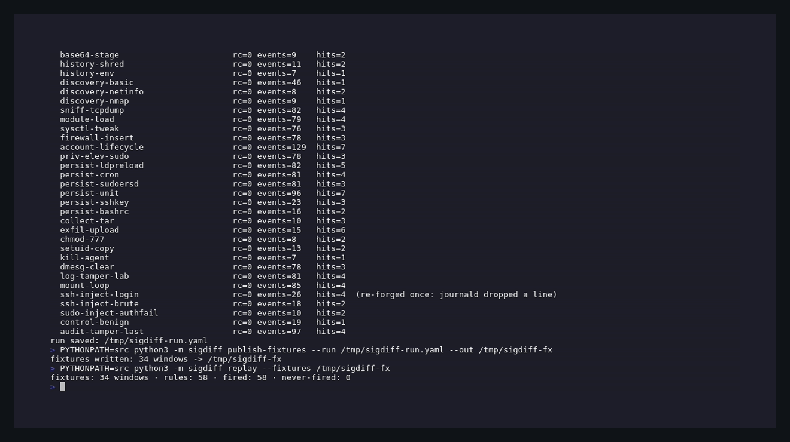
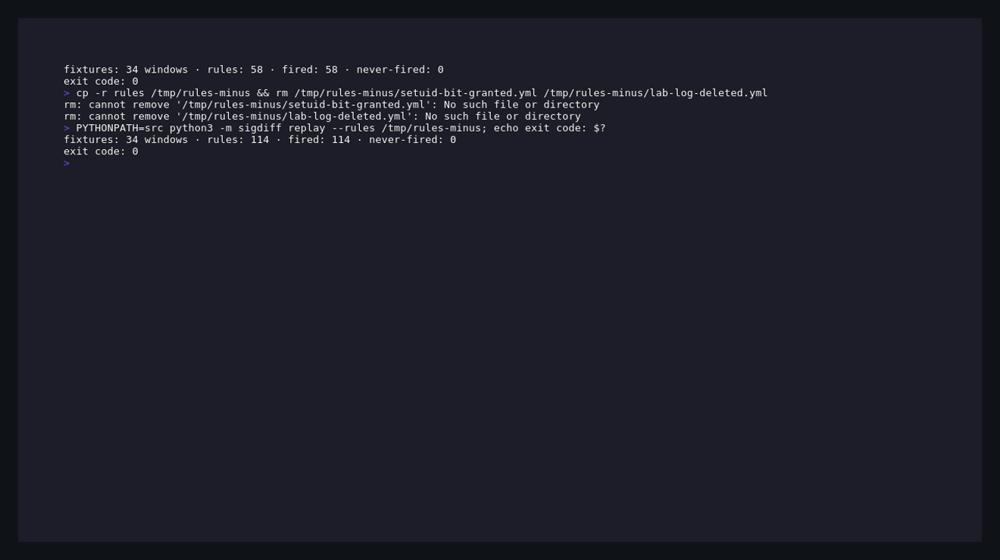
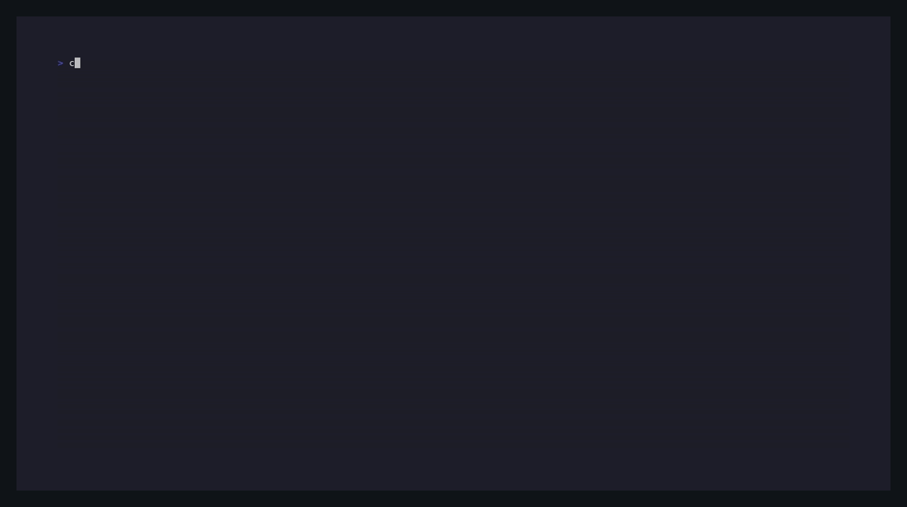

# sigdiff — detection-as-code for Linux telemetry, with a regression test for your detections

You write Sigma rules. Something changes — a rule gets deleted, a field
mapping rots, the host stops producing an event — and **nobody notices until
an incident six months later.** `sigdiff` makes that failure a CI error: it
executes attack techniques on a real Linux host, captures the raw telemetry
each one produces, hashes the normalized events into a baseline, and fails
when a detection that used to fire stops firing.

Three tools in one CLI:

1. **A working subset of the Sigma rule format** — parser, validator,
   compiler to matchers over *this host's* telemetry (auditd, journald,
   syslog-parsed sshd/sudo). Anything the compiler can't understand is a
   hard error, never a silent skip.
2. **A technique runner** — 34 attack techniques + 1 benign control, each
   executed under installed auditd collection rules, captured by file offset
   (auditd) and journald window + flush barrier, normalized into one field
   vocabulary, and hashed per technique.
3. **The diff** — `verify` re-runs everything and exits 1 on lost
   detections; `ablate` runs two rule sets against the same recorded events
   and prints the gain/loss matrix; `replay` matches the rules against the
   committed raw telemetry windows — offline, in CI, forever.



## The measured definition of done, on this host

Arch (kernel 7.3.3-1-cachyos), audit userspace 4.2.1, Python 3.14.
Reproduce end-to-end:

```bash
make install                       # sigdiff + dev deps
make live PW='<sudo pw>'           # installs auditd rules, runs 34 techniques,
                                   # writes run.yaml (the hashed baseline)
make fixtures                      # raw windows out of run.yaml -> fixtures/
make replay                        # rules vs recorded windows, offline
make ablate                        # rules/ vs rules-b/ against the same events
```

| claim | evidence (commands above, this repo) |
|---|---|
| 58 Sigma rules written for this host (50 auditd, 6 auth, 2 journald) | `sigdiff compile` → `58 total · 58 compiled · 0 with errors` |
| every rule fires against real telemetry | `sigdiff replay` → `34 windows · 58 rules · fired: 58 · never-fired: 0`, exit 0 |
| 34 executed techniques (33 attack + 1 control), ≥25 required | `sigdiff run` prints one line per technique; expectations + forbid-lists enforced by `replay` |
| hashed baseline per technique | `run.yaml`: `events_hash` = SHA-256 of the sorted normalized-event set |
| removing a rule is caught | `verify --baseline run.yaml --rules <set minus 2 rules>` → exit 1, names both losses (below) |
| rule-set A vs B vs none | `sigdiff ablate` → matrix in [docs/tables/ablation.md](docs/tables/ablation.md) |
| offline replay committed | `fixtures/` = 34 raw auditd+journald windows (2.1 MB), replayed by CI |
| 28 unit tests green without any root (incl. auditd rotation splice) | `pytest tests/ -q` |

Full per-rule table (58 rows, fired/matches): [docs/tables/replay.md](docs/tables/replay.md).

## The regression story, as it actually ran

`run.yaml` is the recorded live baseline. Two rules were then deleted from a
copy of the corpus and the baseline was re-verified — live, on the host:

```text
$ SIGDIFF_SUDO_PW=… sigdiff verify --baseline run.yaml --rules /tmp/rules-minus
rules changed since the baseline was recorded (rules_hash differs): this run is itself the regression demo if rules were removed on purpose
REGRESSION: technique log-tamper-lab lost the detection lab-log-deleted
REGRESSION: technique setuid-copy lost the detection setuid-bit-granted
verdict: 2 lost detection(s), 0 new hit(s), 32 telemetry drift(s)
exit: 1
```

The same failure offline against the committed fixtures:



**Telemetry drift** is reported separately and never counts as win or loss:
this is a working desktop (a browser connecting, systemd noise). The event
hash is a set of normalized events with timestamps/pids removed, so repeated
identical events collapse and benign churn shows as drift — while a *rule*
going silent is always a hard failure.

## Ablation: what each rule set buys you

`sigdiff ablate --rules-a rules --rules-b rules-b` — same recorded events,
two rule sets:

```text
| technique | no rules | rules A | rules B | A-only | B-only |
|---|---|---|---|---|---|
| control-benign | 0 | 1 | 2 | 0 | 1 |
| history-env | 0 | 1 | 1 | 1 | 1 |
| ssh-inject-login | 0 | 4 | 4 | 1 | 1 |
| persist-cron | 0 | 4 | 6 | 0 | 2 |
…
rule set B gains 2 detection(s): loose-any-bash, loose-etc-touch
rule set B loses 3 detection(s): history-env-modified, ssh-session-opened, suspicious-outbound-1337
```

Set B is set A minus three targeted rules plus two sloppy broad rules. The
matrix (all 34 rows: [docs/tables/ablation.md](docs/tables/ablation.md))
says exactly what that costs: three real detections vanish, and the broad
rules fire on every window — including the benign control.

## How capture works (and where the honesty lives)

- **Collection** (`audit/rules.list`, installed by `sigdiff run` as root):
  execve/connect/mount/module syscalls for this user's login uid, plus
  path/dir watches on the files an attacker persists into
  (`ld.so.preload`, `cron.d`, `systemd/system`, `sudoers.d`,
  `authorized_keys`, the shell rc, the audit dir itself). Modern
  auditd rule syntax only; the installer widens the kernel backlog and
  starts auditd if the desktop session stopped it.
- **The lab boundary** (`src/sigdiff/capture.py`): techniques run with cwd
  under `/tmp/sigdiff-lab`; auditd events without a lab cwd are dropped
  (pathless events — connects, audit-config — are scoped by the login uid
  the collection rules already enforce); auth/journald events must carry the
  `sigdiff` marker or a TEST-NET (203.0.113.0/24) client. This is the
  documented experiment boundary, not the rule set, and the control
  technique (`control-benign`) proves it doesn't rig the outcome: ordinary
  commands fire exactly one rule (a file created in the lab dir) and none
  of the 24 forbidden ones.
- **Determinism**: auditd windows by an `(inode, byte)` anchor into the live
  log — auditd rotates by rename, so the anchor survives as `audit.log.N`
  and the splice reassembles anchor-tail → older rotations → current file
  even when two rotations land inside one window (found live: a busy
  browser pushed 8 MB of noise between a technique's start and its read;
  `tests/test_capture_rotation.py` pins this down);
  journald by exact-time window preceded by a **flush barrier** — a marker
  logged after each technique, waited for before reading, because journald's
  `/dev/log` queue can otherwise hold an earlier line longer than a later
  one. The runner re-applies its log-read ACL whenever auditd rotates files
  mid-run. journald also silently *drops* a `logger` DGRAM under load
  (reproduced twice under a pty harness: one forged auth line per run
  missing although its `connect()` succeeded); the three idempotent
  journal-forge techniques are re-run exactly once by the runner when their
  expected detections are absent from the captured window, and the attempt
  count is recorded in the baseline (`attempts: 2`).
- **Fixtures are raw**: `fixtures/*.audit.log` and `*.journal.jsonl` are the
  exact bytes from `/var/log/audit/audit.log` and `journalctl -o json` for
  each window. `replay` re-parses them through the same parser/rules CI runs.

## What is intentionally *not* here

- No log-shipping, no SIEM, no server. This is a verification harness for
  rules on one host.
- The Sigma subset is documented in `src/sigdiff/sigma.py` (modifiers:
  `contains|startswith|endswith|re`, `|all`, keyword lists, glob values,
  `and/or/not` + `1 of`/`all of` conditions). Aggregations
  (`count`, `near`) and Windows log sources are out of scope; the parser
  raises on anything it can't run.
- The lab user/paths (`meowman`, `/tmp/sigdiff-lab`) are baked into the
  collection rules — this repo verifies *its own host pairing*, like any
  detection repo. Techniques 31–33 forge sshd/sudo lines via `logger`
  (TEST-NET) because this machine has no live sshd auth traffic; the
  techniques say so in `techniques/techniques.yml`.
- `audit-tamper-last` runs dead last on purpose: it clears all auditd rules,
  and that fact is encoded in its name and the runner's ordering, not hidden.

## Repo map

```
rules/                 58 Sigma rules (rules-b/ = the ablation set)
techniques/            34 technique specs (command, expectations, forbid-lists)
audit/rules.list       the auditd collection rules installed during live phases
fixtures/              34 recorded telemetry windows (raw bytes)
tests/fixture_windows/ hand-written windows for the unit tests
src/sigdiff/           events.py (parsers) · mapping.py (field contract) ·
                       sigma.py (rule compiler) · capture.py (windows +
                       boundary) · runner.py (execute + baseline + verify) ·
                       replay.py · ablate.py · cli.py
tools/gen-corpus.py    one spec table regenerates rules/techniques/audit rules
tools/make-assets.sh   rebuilds tables, GIFs, PNGs, demo.cast (`make assets`)
docs/tables/           generated evidence: replay.md, ablation.md
docs/SOURCES.md        every external vocabulary used, and what wasn't
```

## Tests and CI

CI (GitHub Actions, `ubuntu-latest`) runs the fully-offline contract:
ruff → `sigdiff compile` → 28 pytest tests → `sigdiff replay` against the
committed fixtures → ablation. The live phase needs a Linux host with
auditd and sudo, so it is not in CI — its output is committed here as
`fixtures/` and the tables above.

 · [demo.cast](assets/demo.cast) (offline flow, `asciinema play`)

MIT — see [LICENSE](LICENSE) and [docs/SOURCES.md](docs/SOURCES.md).
